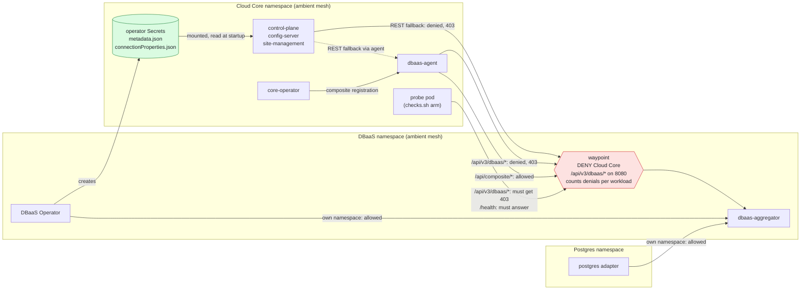
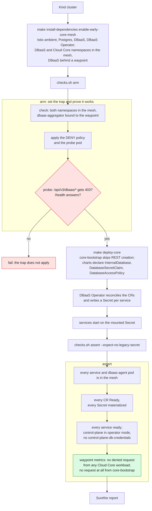
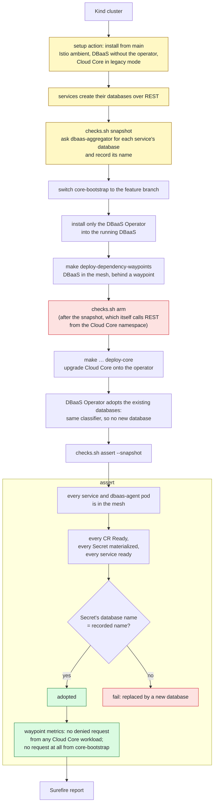

# DBaaS Operator integration tests

These tests check that Cloud Core services get their databases from the DBaaS Operator, through the Secrets it
mounts, and never fall back to provisioning over REST. The services covered are control-plane, config-server, and
site-management.

## How a fallback is caught

The tests run Cloud Core and DBaaS in the Istio ambient mesh, with a waypoint in front of DBaaS. The bootstrap sets
that up (`CORE_MESH_EARLY=true`, `MESH_DEPENDENCY_NAMESPACES=dbaas`). `checks.sh arm` adds an `AuthorizationPolicy` at
that waypoint that denies `/api/v3/dbaas/*` to the Cloud Core namespace (`assets/rest-fallback-trap.yaml`).
Every database lookup or creation over REST from a Cloud Core service is then denied with 403, whether it goes to
dbaas-aggregator directly or through dbaas-agent, and the waypoint counts it by source workload. The rest of the
aggregator stays open, so core-operator still registers the composite structure through dbaas-agent, and the DBaaS
Operator and the database adapters are not affected: they call from their own namespaces.



A DENY rule that does not apply blocks nothing and reports nothing, so the tests prove it applies:

- `arm` calls the denied path from a probe pod in the Cloud Core namespace and requires `403 RBAC: access denied`,
  and calls `/health` and requires an answer.
- The waypoint sees only pods in the mesh. The bootstrap puts the Cloud Core namespace in the mesh before Cloud Core
  is installed, `arm` checks that both namespaces are in the mesh and that dbaas-aggregator is bound to the waypoint,
  and `assert` requires every pod of the services and of dbaas-agent to be captured.
- `assert` reads the waypoint's request metrics and requires no denied request from any Cloud Core workload but the
  probe: the services, dbaas-agent, and anything else, such as a Job. Readiness alone would miss a call that failed
  and was then retried from the Secret. The probe's own denied requests show that the metrics are there to read.
- core-bootstrap must make no request to dbaas-aggregator at all, allowed or denied: in operator mode it no longer
  creates control-plane's database. It runs as the pre-install hook Job of the Cloud Core application chart, deleted
  once it succeeds, so `assert` finds it by the service account in the release's hook manifest. It shows the Job ran
  in the mesh by the namespace label and the Job's own labels, and that the account label is read by the probe's.

The tests need nothing from core-bootstrap beyond what an install already does: Cloud Core keeps its real
`API_DBAAS_ADDRESS`. They do need its DBaaS balancing rules left empty, as they are by default:
`DBAAS_LODB_PER_NAMESPACE_AUTOBALANCE_RULES` and `DBAAS_ON_MICROSERVICES_PHYSDB_RULE` make core-bootstrap call
`/api/v3/dbaas/<namespace>/physical_databases/...`, which has no operator equivalent and which the trap denies.

## Scenarios

| Job | What it proves |
|---|---|
| `clean-install` | Cloud Core installed onto a cluster that already runs the operator comes up, every CR is `Ready`, and core-bootstrap no longer writes `control-plane-db-credentials` |
| `upgrade` | Cloud Core installed as today, then upgraded after the operator is added, keeps the databases it already had: each claim resolves to the database recorded before the upgrade |

`clean-install` installs the dependencies and Cloud Core in two runs, through the `make-targets` input of the setup
action (`install-dependencies`, then `deploy-core`), so the trap is in place before the first Cloud Core pod starts. `upgrade` arms it after the baseline install
and the database snapshot, which itself asks dbaas-aggregator from the Cloud Core namespace.

### Clean install



### Upgrade

Yellow steps run Cloud Core from `main`, before the operator.



## Reports

Each job publishes a Surefire report, as the Java suites in this repository do, so the results can join the
integration tests report. With `REPORT_DIR` set, every check is recorded, and `checks.sh report` writes
`surefire-reports/TEST-<suite>.xml` and `reports/surefire.html` there. The workflow uploads them as
`surefire-reports-dbaas-operator-<scenario>`.

The report runs even when an earlier step failed. If the cluster setup failed and no check ran, or a step failed
outside the checks, it records a `setup` error, so a scenario that never ran shows as failed rather than disappearing
from the report.

## Running

The workflow is `DBaaS Operator integration tests`. The core-bootstrap branch is inlined in it as
`OPERATOR_BOOTSTRAP_BRANCH`, because it exists only while this work is open; the bootstrap derives the core-bootstrap
image and the Core service tags from the branches. `CORETPL_CHART_DIR` is inlined for the same reason: the charts need
`coretpl` 0.2.4, which is packaged from the core-bootstrap branch until it is published. Once this merges, drop both,
and the defaults, `main` and `latest`, apply. `test-branch` stays an input, so the service charts can be taken from
another branch.

To run the checks against your own cluster, for example one installed with `cloud-core-local-dev`:

```bash
./checks.sh arm                              # before Cloud Core is installed or upgraded; see below
./checks.sh assert --expect-no-legacy-secret
```

`arm` needs what the bootstrap sets up with `INSTALL_ISTIO=true CORE_MESH_EARLY=true MESH_DEPENDENCY_NAMESPACES=dbaas`:
the Cloud Core and DBaaS namespaces in the ambient mesh, and DBaaS behind the waypoint `waypoint`.

The namespaces default to those of `cloud-core-local-dev`; set `CORE_NAMESPACE`, `PG_NAMESPACE`, or
`DBAAS_NAMESPACE` only if yours differ. `checks.sh` without arguments prints the other subcommands. It needs
`kubectl`, `helm`, `jq`, `yq`, and `envsubst`.
